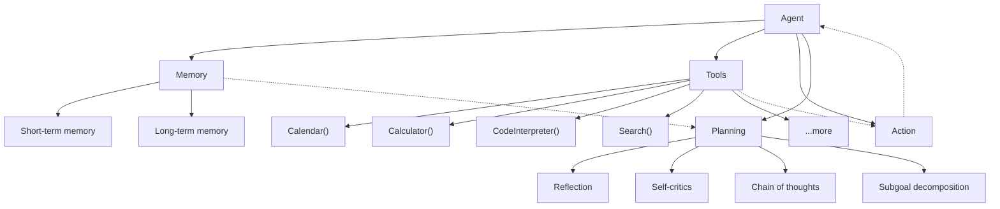
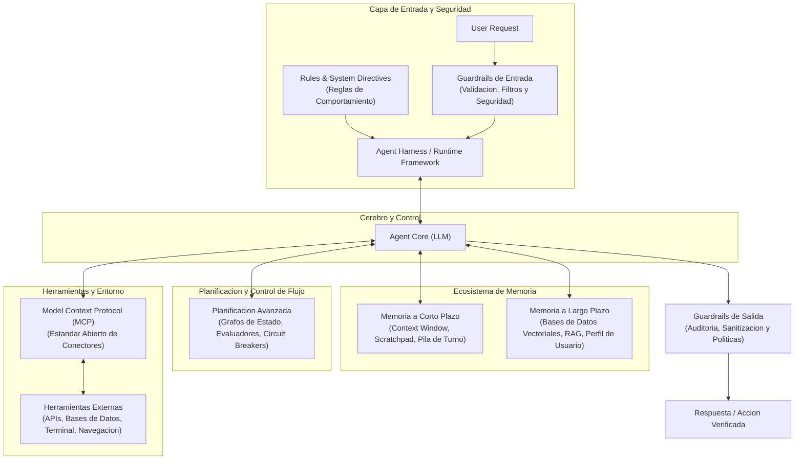

# Arquitectura y Evolucion de Agentes de IA

Este documento registra los fundamentos de la arquitectura de agentes basados en Modelos de Lenguaje Grande (LLMs), partiendo del diseno clasico original y trazando su evolucion hacia los sistemas agénticos modernos de produccion.

---

## 1. La Arquitectura Clasica de un Agente de IA

En el marco fundacional de diseno de agentes autonomos (basado en el referente teorico de Lilian Weng en OpenAI, 2023), un Modelo de Lenguaje Grande (**LLM**) actua como el **cerebro principal** del sistema.

Este cerebro se activa mediante una plantilla de solicitud detallada (*prompt* del sistema) que especifica su operacion y las herramientas disponibles. Opcionalmente, se le puede asignar un **perfil o persona** al agente, definiendo su rol, tono y caracteristicas de dominio.

### Diagrama General Extendido

### Desglose de los Componentes Principales

#### Componente Central: Agente (Cerebro)
* **LLM Core:** El motor de razonamiento central que toma decisiones sobre que camino seguir.
* **Perfil / Persona:** Definicion explicita de identidad, politicas de comportamiento, restricciones y objetivo que guian la ejecucion.

#### Memoria (Memory)
El modulo de memoria almacena todos los registros internos del agente: pensamientos, acciones, observaciones previas e historial de interaccion con el usuario.

1. **Tipos de Memoria:**
   * **Memoria a Corto Plazo (Short-term memory):** Mantiene la informacion del contexto inmediato y de trabajo. Esta limitada por la ventana de contexto (*context window*) y capacidad de procesamiento del momento.
   * **Memoria a Largo Plazo (Long-term memory):** Conserva los comportamientos, aprendizajes y registros a lo largo del tiempo, empleando sistemas externos de almacenamiento para recuperar informacion rapidamente cuando sea necesario.
   * **Memoria Hibrida:** Integra la memoria a corto y largo plazo. Permite al agente razonar en el presente sin perder de vista experiencias pasadas ni saturar la ventana de contexto.

2. **Formatos y Estructuras de Memoria:**
   * Los registros pueden almacenarse en texto en lenguaje natural, listas estructuradas o bases de datos relacionales/vectoriales.
   * **Ejemplo representativo de combinacion (Ghost in the Minecraft / Voyager):** Emplea un esquema hibrido donde las claves son descripciones en lenguaje natural y los valores son vectores de *embeddings* almacenados en bases vectoriales para recuperar habilidades pasadas en funcion de la situacion actual del juego.

#### Planificacion (Planning)
El modulo de planificacion descompone la solicitud general del usuario en subtareas concretas para resolver problemas complejos de forma estructurada. La clase divide este modulo en dos enfoques fundamentales:

1. **Planificacion sin Retroalimentacion (Ruta estatica):**
   * El modelo traza todos los pasos desde el inicio y no los modifica durante la ejecucion.
   * Dificultad principal: Falla en tareas largas o cambiantes donde una respuesta inesperada invalida el plan inicial.
   * **Tecnicas representativas:**
     * *Chain of Thought (CoT):* Razonamiento paso a paso en una sola ruta secuencial.
     * *Tree of Thoughts (ToT):* Exploracion de multiples rutas y ramas de decision alternativas.
     * *Subgoal decomposition:* Descomposicion del objetivo macro en metas intermedias.

2. **Planificacion con Retroalimentacion (Dinamica y Adaptativa):**
   * Permite reflexionar y ajustar el plan en tiempo real segun los resultados observados en cada paso anterior, corrigiendo errores mediante ensayo y error.
   * **Metodologias principales:**
     * **ReAct (Reason + Act):** Combina razonamiento y accion en un ciclo repetido de:
       $$\text{Pensamiento (Thought)} \longrightarrow \text{Accion (Action)} \longrightarrow \text{Observacion (Observation)}$$
       *Ejemplo practico (Buscando informacion del Apple Remote):*
       * *Paso 1:* El modelo piensa que necesita saber que programa original controlaba el Apple Remote. Ejecuta una busqueda web.
       * *Feedback:* Observa los resultados devueltos por el buscador.
       * *Paso 2:* Con la observacion anterior, ajusta el plan y define el siguiente paso (buscar sobre el componente identificado en la respuesta previa).
       * *Paso 3:* Elabora la conclusion final gracias a la retroalimentacion continua entre pasos.
     * **Reflexion:** Mecanismo donde el agente evalua formalmente su rendimiento retrospectivo (*Self-critics*) y almacena lecciones aprendidas en la memoria para no repetir fallos en iteraciones futuras.

#### Herramientas y Acciones (Tools & Action)
Las herramientas amplian el alcance del agente permitiendole interactuar con entornos externos y ejecutar acciones en el mundo real (busquedas web en Wikipedia, calculadoras, motores matematicos, interpretes de codigo para generar graficos o bases de datos).

Los LLMs emplean y coordinan herramientas a traves de diferentes marcos y tecnicas arquitectonicas:

1. **Marcos Principales de Integracion:**
   * **MRKL (Modular Reasoning, Knowledge and Language):** Arquitectura precursora que combina modelos neuronales (LLMs) con modulos expertos simbolicos deterministas (calculadoras, APIs o sistemas de reglas).
   * **Toolformer:** Metodo de entrenamiento donde el LLM aprende de forma autosupervisada a decidir que API llamar, cuando llamarla y que argumentos pasarle.
   * **Function Calling:** Estandar de la industria (introducido por OpenAI) que permite definir esquemas formales de funciones (JSON Schema) en la solicitud para que el modelo responda con llamadas estructuradas garantizadas.
   * **HuggingGPT (JARVIS):** Agente planificador que conecta el LLM con el catalogo de modelos de machine learning de Hugging Face.

2. **Ejemplo de Ejecucion Multimodal y Multi-herramienta (HuggingGPT):**
   * *Consulta:* Describir el contenido de una imagen y contar cuantos objetos de cada tipo aparecen.
   * *Planificacion:* El LLM descompone el problema en subtareas de clasificacion y conteo.
   * *Seleccion y ejecucion:*
     * Selecciona un modelo de vision como **ResNet** para deteccion y conteo.
     * Selecciona un modelo como **GPT-2 Image Captioning** para descripcion textual.
   * *Sintesis:* El agente unifica los resultados en una sola respuesta congruente: *"En la imagen aparecen jirafas y cebras en un campo, contandose 1 jirafa y 2 cebras"*.

---

## 2. La Evolucion hacia Agentes Modernos de Produccion

A medida que los agentes pasaron de ser experimentos academicos a software empresarial y de desarrollo, cada uno de los componentes originales se especializo e incorporo capas criticas de seguridad, control y arquitectura:

---

## 3. Matriz de Comparacion: Clasico vs. Moderno

| Componente | Diseno Clasico (2023) | Diseno Moderno de Produccion |
| :--- | :--- | :--- |
| **Gobernanza y Reglas** | Prompt de sistema basico estatico. | **Rules modulares y dinámicas** cargadas por contexto o dominio. |
| **Seguridad** | Confianza total en el modelo o filtrado simple. | **Guardrails bidireccionales** (entrada/salida), deteccion de jailbreaks e inyeccion indirecta de prompts. |
| **Memoria** | Historial plano de chat inyectado en el prompt. | **Memoria dual desacoplada:** Corto plazo (scratchpad/turnos) y Largo plazo (bases vectoriales, grafos de conocimiento, RAG). |
| **Conectividad de Herramientas** | Funciones ad-hoc, JSON schemas dispersos o wrappers especificos. | **MCP (Model Context Protocol)** como estandar interoperable de conexion a herramientas y fuentes de datos. |
| **Entorno de Ejecucion** | Bucles infinitos de scripts `while`. | **Agent Harness / Runtime** con maquinas de estado (State Graphs), observabilidad, evaluadores y circuit breakers. |

---

## 4. Proximos Pasos de Estudio en este Modulo

1. **Model Context Protocol (MCP):** Arquitectura cliente-servidor y estandarizacion de herramientas.
2. **Estrategias de Memoria:** Memoria episodica, semantica y de trabajo.
3. **Guardrails y Seguridad:** Deteccion de fugas de datos, prevencion de ejecuciones destructivas y alineamiento.
4. **Agent Harness y Orquestadores:** LangGraph, CrewAI, AutoGen y patrones de multi-agentes.
