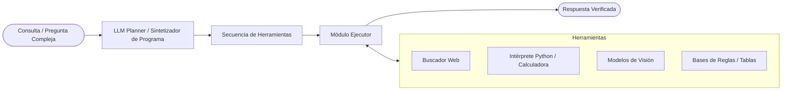

# Chameleon: Framework de Razonamiento Composicional

Chameleon es un framework de razonamiento composicional y aumento de LLMs mediante herramientas (*tool-augmented LLMs*), desarrollado como colaboración de investigación entre UCLA y Microsoft Research.

Su propuesta central es transformar a los Modelos de Lenguaje Grande (LLMs) de simples generadores de texto en planificadores y orquestadores lógicos capaces de componer programas y apoyarse en herramientas especializadas para resolver problemas complejos.

---

## El Problema que Resuelve

Aunque los LLMs puros destacan en generación y fluidez lingüística, presentan limitaciones estructurales conocidas:

1. **Alucinaciones y falta de verificación:** Generan respuestas plausibles pero fácticamente incorrectas.
2. **Razonamiento matemático y formal deficiente:** Tienen dificultades con cálculos aritméticos precisos o lógica algorítmica estricta.
3. **Falta de información en tiempo real:** Están restringidos a su fecha de corte de entrenamiento.
4. **Carencia de percepción multimodal nativa:** Por sí solos, los modelos de texto no pueden analizar o inspeccionar imágenes detalladamente.

---

## Arquitectura y Funcionamiento

Chameleon opera mediante una arquitectura modular en tres etapas principales:

### 1. El Planificador (LLM Planner)
El LLM actúa como un controlador de alto nivel. Ante una consulta (por ejemplo, una pregunta científica o multimodal), el planificador descompone el problema y genera una secuencia ordenada de llamadas a módulos (un "programa").

### 2. Inventario de Herramientas Modulares (Tool Inventory)
El framework define un conjunto extensible de módulos especializados:
* **Buscador Web / Motores de consulta:** Para extraer información fáctica actualizada.
* **Intérprete de Python / Calculadora:** Para operaciones matemáticas, transformaciones de matrices y ejecución de código sin margen de error aritmético.
* **Modelos de Visión por Computadora (CV):** Para tareas de VQA (*Visual Question Answering*), detección de objetos, OCR y segmentación.
* **Módulos de consulta de conocimiento estructurado:** Acceso a tablas o grafos de conocimiento.

### 3. El Ejecutor (Executor)
Ejecuta secuencialmente el programa generado por el planificador, encadenando las salidas de un módulo como entradas del siguiente hasta llegar a la síntesis de la respuesta final.

---

## Ejemplo Conceptual de Flujo

Imagina la siguiente consulta del usuario:
> *"¿Cuál es el área sombreada en la figura adjunta y cuál es el costo del material si cada unidad cuadrada cuesta $14.50 según la tarifa actual de mercado?"*

En lugar de que el LLM intente adivinar el cálculo visual y numérico directamente:
1. **Paso 1 (Visión):** Invoca un modelo de visión por computadora para detectar las dimensiones y formas geométricas en la imagen.
2. **Paso 2 (Web Search):** Invoca el buscador web para confirmar la tarifa de mercado actualizada.
3. **Paso 3 (Python):** Genera y ejecuta un script de Python con las fórmulas geométricas exactas y multiplica el resultado por la tarifa obtenida.
4. **Paso 4 (Síntesis):** Entrega la respuesta final respaldada por la ejecución precisa de cada herramienta.

---

## Chameleon (Framework) vs. Meta Chameleon (Modelo)

Es común confundir ambos términos en la literatura reciente de IA:

| Criterio | Chameleon (Framework - UCLA/Microsoft) | Chameleon (Modelo - Meta AI) |
| :--- | :--- | :--- |
| **Naturaleza** | Framework de software y arquitectura de agentes. | Modelo fundacional multimodal de pesos abiertos (7B / 34B). |
| **Enfoque** | Integración de herramientas externas con LLMs estándar. | Arquitectura *early-fusion* (tokeniza texto e imagen juntos). |
| **Uso Principal** | Orquestación, reducción de alucinaciones y razonamiento por pasos. | Generación y comprensión entrelazada de imagen y texto nativo. |

---

## Relevancia y Legado en el Ecosistema

Chameleon es uno de los precursores directos de los patrones modernos de diseño agéntico:
* Sentó las bases para el uso formal de LLMs como agentes con herramientas (*tool calling / function calling*).
* Inspiró patrones adoptados ampliamente en librerías actuales como LangChain, LlamaIndex y marcos de agentes autónomos.
