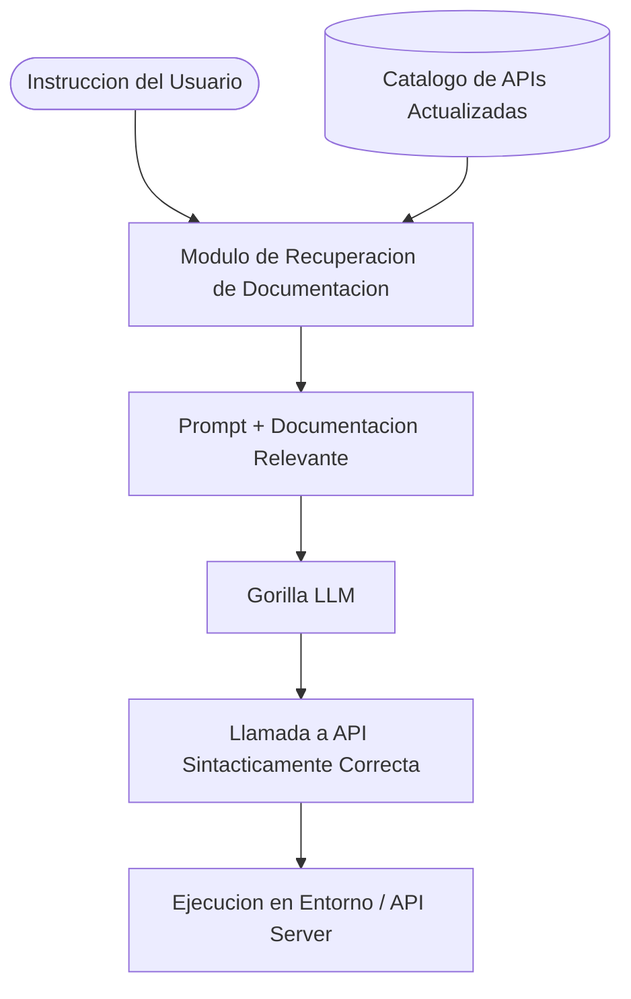

# Gorilla: LLM Especializado en Llamadas a APIs

Gorilla es un modelo y framework de lenguaje desarrollado por investigadores de **UC Berkeley y Microsoft Research**, disenado especificamente para resolver la invocacion precisa de APIs (*API calling*) a gran escala.

---

## Proposito y Problema que Resuelve

A diferencia de las consultas conversacionales comunes, interactuar con APIs externas presenta retos particulares:
1. **Alucinacion de parametros:** Los LLMs convencionales con frecuencia inventan nombres de funciones, parametros inexistentes o formatos incompatibles.
2. **Documentacion cambiante:** Las APIs se actualizan, deprecian endpoints o cambian firmas de argumentos con regularidad.
3. **Escala masiva de bibliotecas:** Existen miles de APIs en ecosistemas como TorchHub, Hugging Face, TensorHub o servicios REST en la nube.

Gorilla fue disenado para superar estos problemas mediante un ajuste fino especializado combinado con un sistema de recuperacion consciente de contexto (*Retrieval-Aware Training*).

---

## Arquitectura y Funcionamiento

### Componentes Clave

1. **Spotlight / TorchHub / HuggingFace / REST:** Catalogo de miles de APIs indexadas con su documentacion tecnica completa y firmas de argumentos.
2. **Retrieval-Aware Training (RAT):** El modelo fue entrenado expresamente para leer la documentacion recuperada en tiempo real antes de generar la llamada, adaptandose de inmediato si la documentacion cambia.
3. **Reduccion drastica de alucinaciones:** Demostro reducir sustancialmente los errores de sintaxis y la generacion de argumentos falsos en comparacion con modelos generales como GPT-4 al momento de invocar funciones complejas.

---

## Comparativa con Otros Enfoques

| Caracteristica | Gorilla (UC Berkeley) | Chameleon (UCLA/MS) | GPT4Tools |
| :--- | :--- | :--- | :--- |
| **Foco principal** | Invocacion estricta y precisa de APIs a gran escala. | Planificacion y razonamiento logico/secuencial. | Uso de herramientas multimodales y visuales locales. |
| **Mecanismo clave** | Retrieval-Aware Training + indexacion masiva de APIs. | Planner LLM + ejecutor de programas modulares. | Instruction tuning con LoRA sobre caja de herramientas. |
| **Casos de uso tipicos**| Descarga y ejecucion de modelos de ML, servicios cloud, librerias. | Problemas matematicos, verificacion factica y VQA. | Segmentacion, generacion de imagenes, OCR, edicion visual. |

---

## Relevancia

Gorilla es una de las referencias fundamentales en el desarrollo de capacidades de llamadas a funciones (*Function Calling* / *Tool Use*) en la industria, mostrando como integrar documentacion viva dentro del bucle de generacion para interactuar con sistemas de software reales.
