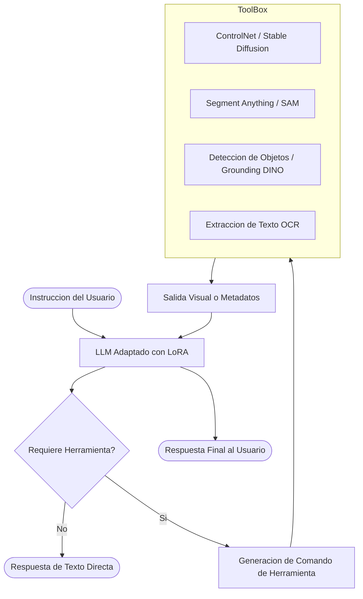

# GPT4Tools: Ensenanza a LLMs para el Uso de Herramientas Multimodales

GPT4Tools es un framework y metodo de entrenamiento desarrollado para permitir que modelos de lenguaje de codigo abierto interactuen de forma eficiente con herramientas visuales y multimodales mediante instrucciones de lenguaje natural.

---

## Proposito y Problema que Resuelve

Modelos avanzados propietarios como GPT-4 poseen fuertes capacidades de comprension, pero muchas alternativas abiertas o locales carecen de la habilidad para:
1. Identificar cuando una solicitud requiere una herramienta externa especializada (por ejemplo, segmentacion, deteccion de bordes o generacion de imagenes).
2. Generar el comando y los argumentos precisos para invocar dicha herramienta.
3. Interpretar el resultado retornado y comunicarlo al usuario de forma coherente.

GPT4Tools aborda esta limitacion generando un conjunto de datos basado en instrucciones generadas por profesores (teacher models) para afinar (fine-tuning) modelos mas pequenos mediante LoRA.

---

## Arquitectura y Funcionamiento

El flujo de GPT4Tools se divide en generacion de datos y ejecucion en tiempo real:

### Componentes Clave

1. **Dataset de Instrucciones Asistidas:** Construccion de ejemplos multi-turno donde se ensena cuando invocar cada herramienta visual con sus parametros exactos.
2. **Ajuste Eficiente con LoRA:** El modelo base de lenguaje no se reentrena por completo; se entrenan adaptadores de bajo rango (LoRA) para aprender la sintaxis y logica de invocacion.
3. **Caja de Herramientas Visuales (Visual Toolset):** Catalogo estandarizado de modelos de vision (como ControlNet, SAM, modelos de deteccion y edicion de imagen) que se ejecutan como funciones llamadas por el modelo.

---

## Caracteristicas Principales

* **Uso de herramientas en modelos locales:** Permite que modelos compactos (como LLaMA o Vicuna) actuen como agentes multimodales sin depender de APIs propietarias.
* **Toma de decisiones contextual:** El modelo aprende no solo a invocar herramientas, sino a decidir activamente si la consulta puede resolverse solo con texto o si requiere una herramienta visual.
* **Interaccion multi-herramienta:** Soporta flujos donde el resultado de una herramienta (por ejemplo, deteccion de bordes) se entrega como entrada a otra (por ejemplo, generacion condicionada de imagen).

---

## Relevancia

GPT4Tools marco un paso importante en el entrenamiento explicito de capacidades agenticas en modelos abiertos, demostrando que el ajuste fino por instrucciones (*instruction tuning*) con adaptadores de parametros eficientes (PEFT/LoRA) es suficiente para dotar a un modelo de habilidades de uso de herramientas complejas.
