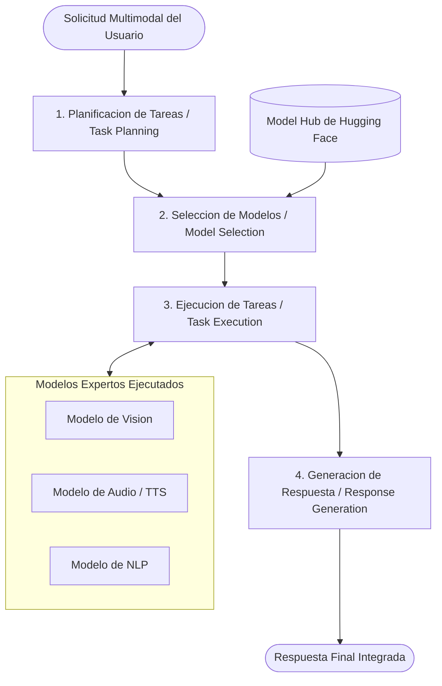

# HuggingGPT (JARVIS): LLM como Controlador de Modelos de IA

**HuggingGPT** (tambien conocido como **JARVIS**) es un framework desarrollado por la **Universidad de Zhejiang y Microsoft Research**, disenado para conectar modelos de lenguaje grande (como ChatGPT) con el ecosistema de modelos de machine learning de codigo abierto alojados en **Hugging Face**.

Su concepto fundamental es utilizar al LLM como el **"cerebro" o controlador central** que planifica tareas, selecciona modelos expertos de la comunidad y coordina su ejecucion para resolver problemas multimodales complejos.

---

## Proposito y Problema que Resuelve

1. **Limitaciones monomodales:** Un modelo de lenguaje puro no puede generar audio, detectar poses humanas, transcribir voz o segmentar video por si mismo.
2. **Fragmentacion de modelos expertos:** La comunidad de IA produce miles de modelos altamente especializados para tareas especificas (por ejemplo, Whisper para audio, ControlNet para imagenes, CLIP para emparejamiento), pero no existia un mecanismo automatico para que cooperaran entre si.
3. **Coordinacion autonoma:** HuggingGPT resuelve como conectar una intencion humana en lenguaje natural con el modelo correcto dentro de un catalogo inmenso sin intervencion manual.

---

## Arquitectura y las 4 Etapas del Framework

HuggingGPT opera en un ciclo estructurado de 4 fases principales:

### 1. Planificacion de Tareas (Task Planning)
El LLM analiza la solicitud del usuario, la descompone en un grafo de tareas mas pequenas (subtareas estructuradas en formato JSON) e identifica las dependencias entre ellas (por ejemplo, si la salida de la tarea A es la entrada de la tarea B).

### 2. Seleccion de Modelos (Model Selection)
A partir de la descripcion de las subtareas y las especificaciones de los modelos disponibles en Hugging Face, el LLM evalua y selecciona el modelo mas calificado segun:
* Tipo de tarea admitida (por ejemplo, `image-to-text`, `text-to-speech`, `object-detection`).
* Metricas de popularidad y rendimiento en el hub.

### 3. Ejecucion de Tareas (Task Execution)
Los modelos seleccionados se descargan o invocan mediante inferencia para ejecutar sus respectivas subtareas de acuerdo con el orden establecido en la etapa de planificacion.

### 4. Generacion de Respuesta (Response Generation)
El LLM recopila las predicciones, salidas numericas, imagenes, audios y textos producidos por todos los modelos expertos, y genera una respuesta final redactada de manera fluida y coherente para el usuario.

---

## Ejemplo Conceptual de Flujo

Solicitud del usuario:
> *"Describe que ocurre en la imagen adjunta, cuenta cuantas personas hay y genera un archivo de audio leyendo esa descripcion en voz alta."*

Flujo de ejecucion en HuggingGPT:
1. **Planificacion:**
   * Tarea 1: Descripcion de imagen (`image-to-text`).
   * Tarea 2: Deteccion de objetos (`object-detection`), dependiente de la imagen.
   * Tarea 3: Sintesis de voz (`text-to-speech`), dependiente del texto generado en las tareas 1 y 2.
2. **Seleccion de Modelos:**
   * Tarea 1 -> Modelo BLIP.
   * Tarea 2 -> Modelo DETR o YOLO.
   * Tarea 3 -> Modelo SpeechT5 o FastSpeech.
3. **Ejecucion:** Invoca secuencialmente cada modelo en su entorno de ejecucion.
4. **Respuesta:** Devuelve el resumen textual de lo observado, el recuento de personas y el archivo de audio producido.

---

## Comparativa dentro del Ecosistema de Frameworks

| Criterio | HuggingGPT (Zhejiang/MS) | Chameleon (UCLA/MS) | Gorilla (UC Berkeley/MS) |
| :--- | :--- | :--- | :--- |
| **Rol del LLM** | Coordinador general de un hub de modelos de ML. | Planificador logico y sintetizador de programas. | Generador estricto de llamadas sintacticas a APIs. |
| **Caja de Herramientas** | Cientos de modelos de Hugging Face (vision, voz, video). | Conjunto acotado: Python, web search, modulos de vision. | Miles de APIs REST, TorchHub y bibliotecas cloud. |
| **Punto Fuerte** | Tareas multimodales interdisciplinarias complejas. | Razonamiento logico, matematico y reduccion de alucinaciones. | Cero alucinacion en firmas y parametros de invocacion. |

---

## Relevancia

HuggingGPT fue uno de los primeros trabajos en materializar el concepto de **IA centrada en agentes orquestadores**: demostro que no es necesario crear un unico modelo gigante que sepa hacer todo, sino que un LLM capaz de razonar puede actuar como director de orquesta sobre una coleccion de modelos expertos mas pequenos y especializados.
