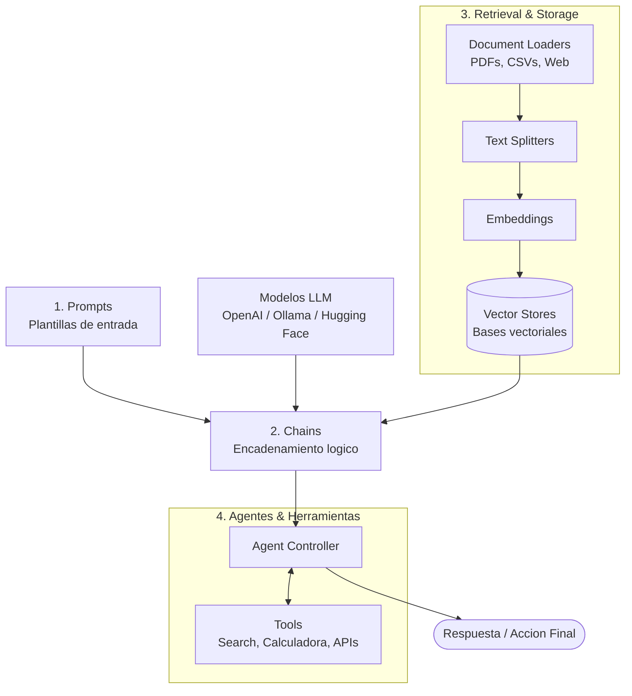

# LangChain: Framework de Desarrollo de Aplicaciones con LLMs

**LangChain** es un framework de código abierto desarrollado principalmente en **Python** (con soporte oficial también para **JavaScript / TypeScript**) diseñado para facilitar la creación, integración y puesta en producción de aplicaciones avanzadas basadas en Modelos de Lenguaje Grande (LLMs).

Su propósito fundamental es desacoplar el modelo de lenguaje y actuar como un pegamento arquitectónico que permite conectar LLMs con fuentes externas de datos, APIs, bases de conocimiento y herramientas del entorno.

---

## 1. Componentes Nucleares de la Librería

LangChain organiza el ciclo de desarrollo de una aplicación con LLMs a través de módulos clave:



### 1.1 Prompts (Plantillas de Instrucción)
Permite construir y parametrizar solicitudes hacia los modelos mediante variables dinámicas, ejemplos de pocas muestras (*few-shot*) y formateadores de salida estandarizados.

### 1.2 Model I/O (Conectores de Modelos)
Proporciona una interfaz unificada para interactuar indistintamente con múltiples proveedores:
* Modelos propietarios en la nube: OpenAI (GPT-4), Anthropic (Claude), Google (Gemini).
* Modelos de código abierto locales o autohospedados: a través de **Ollama** o el hub de **Hugging Face**.

### 1.3 Chains (Cadenas)
Mecanismo para enlazar secuencialmente varias llamadas a modelos, funciones de transformación y flujos lógicos. Una cadena toma una entrada, la procesa a través de varios pasos (por ejemplo: recuperar un dato, formatearlo y generar un resumen) y entrega un resultado final.

### 1.4 Retrieval y Almacenamiento (Sistemas RAG)
Facilita la construcción de arquitecturas de Generación Aumentada por Recuperación (*Retrieval-Augmented Generation*):
* **Document Loaders:** Conectores para extraer contenido desde cientos de formatos y orígenes (PDFs, Notion, Google Drive, URLs web, bases de datos SQL).
* **Text Splitters:** Algoritmos para dividir documentos extensos en fragmentos manejables según límites de tokens.
* **Embeddings & Vector Stores:** Generación de vectores de significado semántico y almacenamiento en bases de datos vectoriales (como Chroma, Pinecone, FAISS, Milvus) para realizar búsquedas de similitud en tiempo real.

### 1.5 Memory (Memoria)
Proporciona una interfaz estándar para dotar de persistencia del estado y memoria a los modelos de lenguaje:
* Permite almacenar y recordar el historial de interacciones pasadas entre llamadas sucesivas.
* Evita que el modelo empiece desde cero en cada turno conversacional, mejorando la coherencia y el conocimiento contextual a lo largo del tiempo.

### 1.6 Agentes (Agents) y Herramientas (Tools)
A diferencia de las cadenas rígidas que siguen un camino predefinido, un **agente** utiliza al LLM como motor de razonamiento para decidir dinámicamente qué pasos tomar:
* Evalúa la consulta del usuario.
* Decide si necesita invocar una herramienta externa (como una calculadora, una llamada a la API de Wikipedia, un buscador web o integración con Zapier).
* Observa el resultado y repite el bucle hasta llegar a la respuesta definitiva.

### 1.7 Callbacks (Ganchos y Telemetría)
Sistema de eventos que permite conectarse a las diferentes fases de ejecución de una cadena o agente:
* Registro y auditoría en tiempo real de entradas y salidas intermedias.
* Medición de latencias, consumo de tokens y depuración de errores durante el flujo.

---

## 2. Ecosistema Completo de LangChain

LangChain ha evolucionado de ser una simple librería de scripting a una suite integral que abarca desde la experimentación hasta el ciclo de vida en producción:

| Herramienta / Módulo | Propósito y Función |
| :--- | :--- |
| **LangChain Core & Community** | La librería base de código abierto con abstracciones de cadenas, modelos y conectores comunitarios (Zapier, Databricks, PostgreSQL, Slack, etc.). |
| **LangGraph** | Extensión para orquestar agentes avanzados mediante **grafos de estado cíclicos**, flujos de control de decisión y arquitecturas multi-agente. |
| **LangServe** | Módulo para desplegar cualquier cadena o agente de LangChain como una API REST lista para producción (basada en FastAPI). |
| **LangSmith** | Plataforma de grado empresarial para **depuración (debugging), observabilidad, trazabilidad de llamadas de tokens, evaluación y testing** de aplicaciones LLM en producción. |

---

## 3. Ejemplos de Uso en Python

La instalación básica de la librería y sus conectores se realiza mediante pip:

```bash
pip install langchain langchain-openai wikipedia
```

### 3.1 Cadena Básica (LCEL)

Estructura elemental para parametrizar un prompt y enlazarlo a un modelo:

```python
from langchain_core.prompts import PromptTemplate
from langchain_openai import ChatOpenAI

# 1. Definicion del modelo
llm = ChatOpenAI(model="gpt-4o-mini", temperature=0)

# 2. Definicion de la plantilla
prompt = PromptTemplate(
    input_variables=["tema"],
    template="Explica brevemente y de forma concisa que es {tema} para un estudiante de IA."
)

# 3. Composicion de la cadena
chain = prompt | llm

# 4. Invocacion
respuesta = chain.invoke({"tema": "RAG"})
print(respuesta.content)
```

### 3.2 Agente con Herramientas Externas (Wikipedia + Calculadora)

A pesar de su poder, los LLMs tienen limitaciones, como la falta de información contextual o incapacidad para realizar operaciones matemáticas complejas. Para superar estas limitaciones, se les brinda **acceso a herramientas complementarias** como motores de búsqueda, calculadoras o APIs externas.

```python
# pip install wikipedia
from langchain.agents import load_tools
from langchain.agents import initialize_agent
from langchain.agents import AgentType

# 1. Definicion de herramientas: Wikipedia (factual) y calculadora matematica (llm-math)
tools = load_tools(["wikipedia", "llm-math"], llm=llm)

# 2. Inicializacion del agente con patron Zero-Shot ReAct
agent = initialize_agent(
    tools,
    llm,
    agent=AgentType.ZERO_SHOT_REACT_DESCRIPTION,
    verbose=True
)

# 3. Ejecucion de la consulta compuesta
agent.run("When was Barack Obama born? How old was he in 2022?")
```

#### Traza de Ejecución Interna (Bucle ReAct)

Al ejecutar el agente con `verbose=True`, se aprecia cómo razona y delega en lugar de adivinar:

1. **Pensamiento (Thought):** El modelo reconoce que no tiene la fecha exacta confirmada en su contexto y decide que debe buscar en Wikipedia.
2. **Acción (Action):** Invoca la herramienta `Wikipedia` con el término `"Barack Obama"`.
3. **Observación (Observation):** La API de Wikipedia devuelve el artículo con su fecha de nacimiento: *4 de agosto de 1961*.
4. **Pensamiento (Thought):** Con la fecha confirmada (1961), identifica que ahora debe calcular la edad en el año 2022, requiriendo una resta aritmética ($2022 - 1961$).
5. **Acción (Action):** Invoca la herramienta `Calculator` pasando la expresión matemática `2022 - 1961`.
6. **Observación (Observation):** La calculadora devuelve el resultado exacto: `61`.
7. **Respuesta Final:** *"Barack Obama nació el 4 de agosto de 1961 y en 2022 tenía 61 años de edad."*

---

## 4. Casos de Uso Comunes en la Industria

LangChain se adapta a una amplia variedad de aplicaciones prácticas según la necesidad del proyecto:

1. **Agentes Autónomos de Larga Duración:** Admite el desarrollo de agentes como AutoGPT y BabyAGI, diseñados para ejecutar planes multi-paso complejos de forma autosuficiente hasta alcanzar una meta.
2. **Simulaciones de Agentes:** Creación de entornos virtuales controlados donde múltiples agentes interactúan entre sí o reaccionan a eventos simulados, permitiendo estudiar dinámicas sociales y memoria a largo plazo.
3. **Asistentes Personales Contextuales:** Asistentes capaces de recordar preferencias pasadas, acceder a datos privados del usuario y realizar acciones en su nombre.
4. **Respuestas a Preguntas sobre Documentos (Q&A / RAG):** Localización precisa de respuestas basadas exclusivamente en el contenido de manuales, PDFs o normativas internas.
5. **Chatbots Avanzados:** Construcción de sistemas de diálogo conversacionales mucho más potentes que los bots tradicionales basados en árboles de decisión rígidos.
6. **Consulta de Datos Tabulares y SQL:** Conexión de LLMs a archivos CSV, hojas de cálculo y bases de datos relacionales SQL para formular consultas en lenguaje natural y obtener respuestas estructuradas.
7. **Comprensión y Análisis de Código:** Análisis estático, auditoría y resolución de dudas sobre bases de código alojadas en repositorios como GitHub.
8. **Interacción con APIs y Servicios Externos:** Capacidad para consultar información en tiempo real de terceros (servicios meteorológicos, cotizaciones, CRM) y ejecutar acciones en sistemas externos.
9. **Extracción Estructurada de Datos:** Transformación y parseo de grandes volúmenes de texto no estructurado (correos, noticias, contratos) en formatos limpios como JSON o tablas.
10. **Resumen de Textos Extensos:** Técnicas de procesamiento por fragmentos (*map-reduce*, *refine*) para resumir libros o documentos gigantes que superan la ventana de contexto estándar de un LLM.
11. **Evaluación de Modelos de Lenguaje (Evaluation):** Herramientas y comandos específicos para evaluar la calidad, precisión y alucinación de los modelos generativos mediante benchmarks y evaluación asistida por LLMs.
